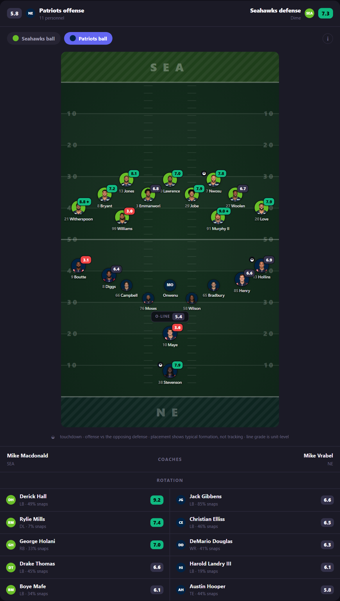

# NFLDB

NFLDB is an NFL analytics application for exploring games, comparing players and
breaking down performance by situation. It uses nflverse data from 1999 onward.

**[Live site](https://nfl-db.cloud.run)** · [Methodology](api/docs/METHODOLOGY.md)



- **Games:** scores, win probability, matchup lineups and passing/rushing charts.
- **Players and teams:** career statistics, game logs, rosters, standings and leaders.
- **Splits:** compare players or teams by down, field position, opponent and other situations.
- **Ratings:** player game ratings calibrated by position, plus team power rankings
  and offensive-line unit grades.
- **Ask NFLDB:** natural-language statistics lookup through tools that query the
  application's data services.

## Architecture

**React + TypeScript → FastAPI → DuckDB.** TanStack Query manages frontend
requests and caching; the HTTP client uses types generated from FastAPI's
OpenAPI schema.

A separate Python/R pipeline prepares analytics using the pinned nflfastR
calculator. It checks statistics, source coverage and API responses before
publishing a versioned database. GitHub Actions builds and deploys the frontend,
API and selected database as one Docker image on Google Cloud Run.

The API reads that database without modifying it. Live scores come from a
separate cached scoreboard service. See [architecture](docs/ARCHITECTURE.md)
for the component map.

## Local development

Requires **Python 3.12**, **Node.js 22** and **uv 0.11.23**.

[Download a prepared database](docs/CLOUD_RELEASES.md) and set `NFL_DB_PATH` to
its `release/nfl.duckdb`. Downloading a cloud release requires access to the
publication bucket. Data is not included in the repository.

Start the backend:

```sh
cd api
uv sync --locked
uv run --locked uvicorn main:app --reload
```

In another terminal, start the frontend:

```sh
cd frontend
npm ci --legacy-peer-deps
npm run dev
```

Open **http://localhost:5173**. The API runs on port 8000, with interactive endpoint
documentation at **http://localhost:8000/docs**. Assistant requests additionally
require `ANTHROPIC_API_KEY` and use billed model calls.

Run backend tests with `uv run --locked pytest` from `api/`. From `frontend/`,
run `npm run build` for type checking and production assets, or
`npm run test:e2e` for browser tests. Install the test browser first with
`npx playwright install chromium`. Model evaluations are opt-in.

## Documentation

- [Methodology and coverage](api/docs/METHODOLOGY.md): ratings, metric definitions
  and unavailable historical fields.
- [Data map](docs/DATA_MAP.md): sources, service owners and join relationships.
- [Data preparation](docs/DATA_PIPELINE.md): ingestion and analytics builders.
- [Refresh automation](docs/NATIVE_REFRESH_AUTOMATION.md): scheduled validation
  and publication.
- [Deployment](DEPLOY.md): container builds, production releases and rollback.
