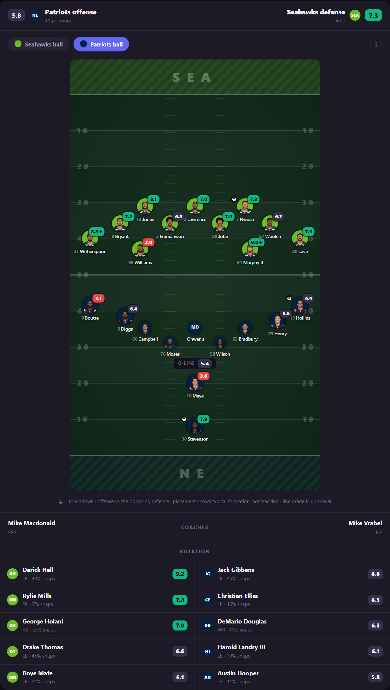
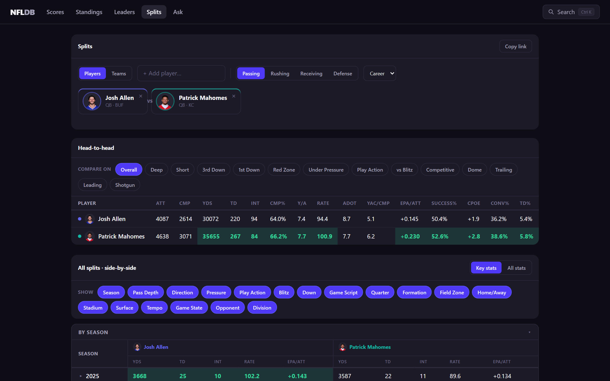
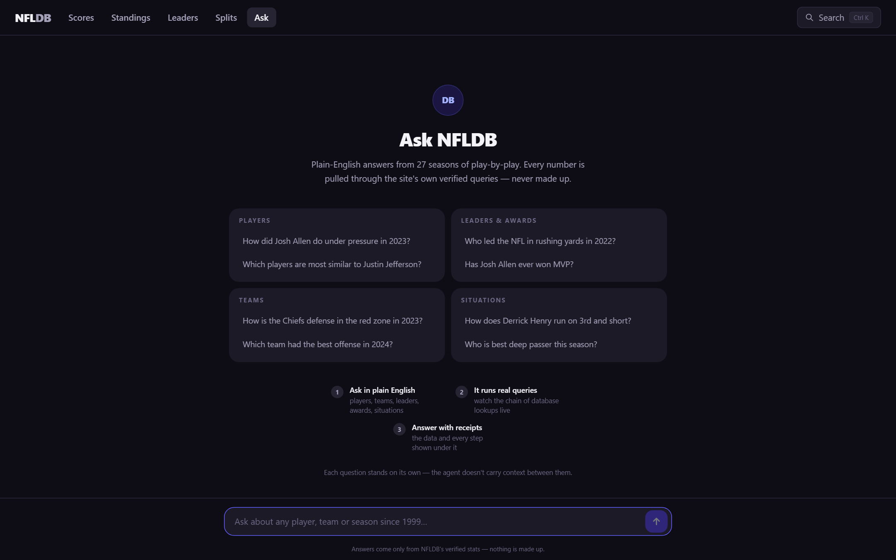
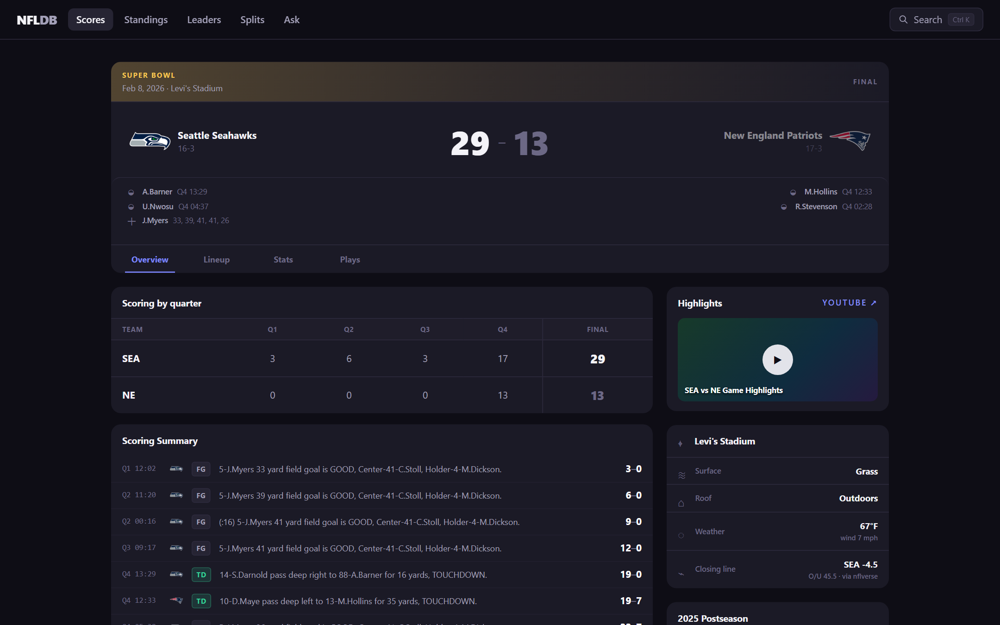
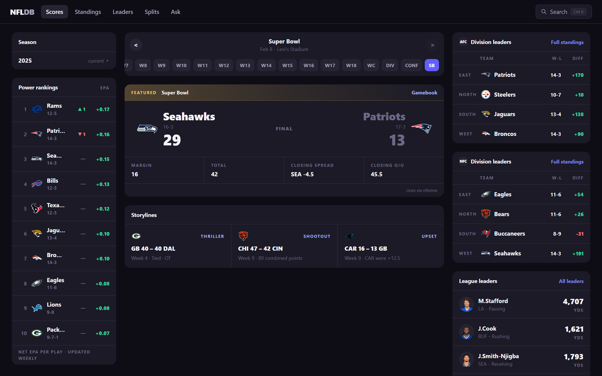

# NFLDB — NFL Analytics, Game Ratings & Situational Splits

A full-stack NFL analytics platform built on nflfastR play-by-play data. It
provides **per-game player ratings** (EPA-based, percentile-calibrated across
28 stored seasons) rendered on a **matchup lineup view**, a **situational splits
engine** that conditions any player's or team's stat line on one dimension at
a time, and **Ask NFLDB**, an agent that answers plain-English questions
through the platform's typed queries. Preparation validates supported statistics,
source coverage, and API responses before publishing a release.

**[Live site →](https://nfl-db.cloud.run)** &nbsp;·&nbsp; **[Deployment guide →](./DEPLOY.md)**



---

## Features

- **Per-game player ratings, free.** Every skill player, defender, and kicker
  gets a 3.0–10.0 grade per game, computed from play-by-play EPA and defensive
  event stats and percentile-calibrated over 436,000+ player-games, so a 9.0
  is a top-2% performance. Comparable per-game grades are usually behind a
  subscription; here they cost nothing. Offensive lines get a unit grade
  (public data records nothing per-blocker, so nothing per-blocker is
  invented).
- **The lineup view.** Each game renders one team's offense against the
  other's defense in their actual personnel packages, with rating badges on
  every player and popups charting each passer/receiver's targets by lane and
  depth and each back's carries by gap — exact counts at the data's real
  resolution.
- **Situational splits.** Compare players or teams head-to-head, then break
  any one of them down across 18 dimensions — down, pass depth, pressure,
  play-action, blitz, red zone, dome, competitive-snaps-only, per-opponent,
  and more — with a panel that surfaces where they stand out. Works for
  offense and defense, players and teams.
- **Ask NFLDB.** A tool-calling agent that uses shared data services and
  structured query tools. Answers include the database lookups behind them.
  Model and streaming improvements are a subsequent milestone.
- **Validated releases.** Passing and receiving splits use the pinned nflfastR
  calculator with detailed player credits. Release checks cover all stored
  seasons, counting-stat reconciliation and explicit historical field gaps.
- **Performance.** gzip (payloads 10–20× smaller), HTTP caching, point-lookup
  indexes, per-request cursors for lock-free concurrent reads, and a pruned
  columnar store.

| Splits explorer — head-to-head, then 18 dimensions at once | Ask NFLDB — verified stats, with receipts |
|---|---|
|  |  |

| Game page — scoring, win probability, team stats | Home — scores, power rankings, storylines |
|---|---|
|  |  |

---

## Engineering notes

### Data accuracy
- The offline R worker runs `nflfastR::calculate_stats` on filtered play subsets.
  Detailed player credits preserve production on lateral and multi-passer plays.
  Native passing/receiving validation compares the captured calculator outputs,
  split conservation, and independent weekly counting totals.
- Historical targets are unavailable for 2003–2008, receiving yards after catch
  before 2006, and receiving air yards before 2009. Availability is tracked per
  field while separately verified catches, yards and touchdowns remain visible.
- Passing split aggregation retains the numerator and population for each rate.
  Combined views recompute rates from those components, including sack-only EPA
  rows and the modeled-throw population for CPOE.
- Source replay and whole/split reconciliation are release gates in
  `api/pipeline/receiving_validation.py` and `passing_validation.py`.
  [`api/tests/test_reconciliation.py`](api/tests/test_reconciliation.py) adds
  invariants against the real database inside the shipped image.

### Performance
- Responses gzip ~10–20× (a veteran's splits payload: 570KB → 46KB) — the
  dominant transfer cost.
- HTTP caching: completed seasons are immutable → cached a week; live data →
  5 min.
- ART point-lookup indexes on the large per-request tables, and per-request
  DuckDB cursors (MVCC-isolated) so concurrent reads never serialize on a
  lock.
- The earlier play-by-play pruning benchmark reduced 396 columns to 169 and
  the then-current database from 872MB to 400MB (every builder and
  query re-verified against the slim schema).

### The ratings engine
- Per-game grades from raw play-by-play: QB/RB/WR/TE rate on total EPA over
  their plays; defenders on a weighted event score (sacks, TFLs, INTs,
  PBUs…); kickers on made-vs-expected by distance. Raw scores map through a
  piecewise percentile curve calibrated across the loaded history: 6.5 average,
  8+ great, 9+ elite (~top 2%).
- Validated against history: the all-time top-rated QB games are
  Roethlisberger's perfect-rating 2014 game, Brady 2007, and Foles's 7-TD
  game; team power rankings (net EPA/play, early-season shrinkage) put the
  actual Super Bowl teams at the top of each season.
- Known limits are stated: O-lines are graded as a unit on what they allow
  together (sack/QB-hit rate + stuffed-run rate) because public data
  attributes nothing to individual blockers; the UI says so.
- A layered ID crosswalk joins snap counts (PFR ids) to play-by-play (GSIS
  ids) at ~98%+ per game — PFR id → id-map table → normalized name+position —
  so lineups, snaps, and ratings agree on who's who.

### The splits engine
- Long-format materialized tables (`player_splits`, `defense_splits`,
  `team_splits`): one row per `(entity, season, category, dimension, value)`,
  so "overall" always reconciles with the sum of its splits — one source of
  truth.
- Single-dimension by design — no combinatorial explosion of cross-products.
- FTN charting (play-action, blitz, defenders-in-box) joined to the
  play-by-play for 2022+; defensive splits built by unioning 20 per-defender
  credit columns into an events stream.

### Full-stack, typed end-to-end
- FastAPI + Pydantic → OpenAPI → `openapi-typescript` codegen → a fully typed
  React/TypeScript client. A schema change flows to the frontend types
  automatically; no hand-written, drift-prone interfaces.

## Ask NFLDB — the question-answering agent

Ask NFLDB answers natural-language questions about NFL statistics — "How many
rushing yards did Derrick Henry have against stacked boxes in 2023?" — using
only the platform's verified data. It is a Claude tool-calling agent with 17
typed tools. To answer a question, the model first resolves any player or
team name to a database ID (`resolve_entity`), then calls tools that return
verified numbers: season and career stats, game logs and box scores,
standings, leaders, situational splits, power rankings, and player
comparables. A `query_plays` tool covers granular situations the shaped tools
can't express (for example, a team's red-zone rushing touchdowns): the model
submits structured filters and the server composes the SQL from a whitelist —
the model never writes SQL itself. A `get_methodology` tool answers questions
about the platform itself — how grades are calibrated, what EPA means here, why
a season is not covered — by returning a named section of the project's own
methodology document, so an explanation is retrieved rather than recalled on the
same terms as every figure. Answers stream over SSE, follow-up
questions carry text context, sampling is disabled (temperature 0), and each
question has a hard 10-tool-execution budget and per-IP rate limiting. Both
assistant paths also stop after at most 11 model turns, even if the model keeps
requesting tools after a denial or repeatedly supplies invalid calls. If it
still requests tools on the last turn, the assistant returns a retry message
instead of presenting intermediate text as a completed answer.

The design constraint throughout is that statistical definitions live in
code, not in the prompt. Official totals are reconciled regular-season-only
numbers; terms like "pressure," "deep," and "success rate" mean the
platform's charted definitions; a vocabulary contract maps everyday football
phrasing onto exact split values. The model can choose which tools to call,
but it cannot redefine what a statistic means.

The agent is evaluated on a 123-question gold set whose expected answers are
computed live from the same verified query layer. The eval grades both tool
routing and the written answer, and is opt-in because it makes billed model
calls. It has caught a real regression: during development, a broken tool
chain scored 88%; the eval isolated the cause, and the fix was re-verified at
100%.

Rather than one blended score, the eval reports a per-category capability
matrix, so weak areas are visible instead of averaged away:

| Category | Cases | What it tests |
|---|---:|---|
| Season/career/award lookups | 32 | totals, awards (polarity-graded), draft |
| Situational splits — offense | 24 | 15 of the 16 offensive split dimensions |
| Situational splits — defense | 6 | defensive splits by play type, down, script |
| League leaders | 18 | incl. kicking, punting, and defensive stats |
| Teams & standings | 11 | records, team splits |
| Phrasing robustness | 12 | terse/misspelled/nicknamed paraphrases of other cases |
| Historical eras | 10 | 1999–2007 seasons, relocated-franchise codes (OAK/SD) |
| Coverage honesty | 10 | declines outside data coverage + gap logging |
| Games & box scores | 5 | scores, playoffs, coaches, quarter detail |
| Play-by-play queries | 4 | granular structured filters |
| Ambiguous names | 4 | two players sharing a name; context must pick one |
| Multi-turn follow-ups | 4 | text-context carryover |
| Methodology | 13 | how the platform computes things, routed by topic |

(Categories overlap — a case can carry several tags.) Graders are themselves
unit-tested in both directions: each must accept the phrasings a correct
answer takes *and* reject wrong-but-plausible answers, so the headline number
cannot be inflated by a grader that can't fail.

The 13 methodology cases are the newest and **have not been run yet** — the
eval is billed, so every figure below covers the 110 cases that predate them.
They assert the *topic* `get_methodology` was called with rather than merely
that it was called: a closed vocabulary makes retrieval itself gradeable,
which similarity ranking never is. They are also the only cases the
text-to-SQL baseline cannot attempt, since a methodology answer lives in a
document rather than in the database.

Every run also performs a mechanical provenance audit: each numeral in each
answer is checked (numerically, tolerating rounding and percent scaling)
against the tool results fetched for that question, and answers containing
figures with no tool-result source are reported. This measures the project's
core claim — the model never invents a number — directly, without an LLM
judge.

Latest run (claude-haiku-4-5): **105/110 both-correct (95%), 109/110 answer
accuracy (99%)**, 3.7s and ~18,800 tokens per question. The five imperfect
cases are tracked model weaknesses, not grader noise — one wrong answer
(an award question answered from a tool that carries no awards data) and
four routing preferences (play-by-play fallback chosen over shaped split
tools) — and the provenance audit flagged 15 answers: 14 legal derivations
shown with their arithmetic, plus one true grounding violation (a figure
repeated from conversation history instead of re-fetched) now on the fix
list. Keeping these failures visible is the point of the matrix.

To test whether the typed-tool design is actually necessary, the repository
also contains a text-to-SQL baseline: the same model given the full database
schema and asked to write SQL directly, evaluated on the identical questions
and graders. The comparison runs on the 56 statistical questions both
architectures can attempt — the methodology cohort has no SQL equivalent,
because the answer is in a document rather than the database. It was measured twice — first with the raw schema, then again
after adding an accurate data dictionary (table grain, join recipes, name
formats, value vocabularies) to remove documentation gaps as an excuse.

| Architecture | Accuracy* | Avg latency | Tokens/question |
|---|---:|---:|---:|
| Typed tools + semantic layer | 56/56 (100%) | 3.7s | ~18,100 |
| Text-to-SQL v2 (with data dictionary) | 37/56 (66%) | 2.6s | ~8,200 |
| Text-to-SQL v1 (raw schema) | 21/56 (38%) | 3.1s | ~7,800 |

\* measured on the original 56-question set; the expanded 110-question matrix
above supersedes it for tracking the typed agent.

All arms run claude-haiku-4-5 (~$0.27 per eval run for the typed agent, with
88% of its input tokens served from prompt cache; ~$0.50 for the baseline).
The typed agent spends more tokens and latency per question on its tool loop;
that is the cost of the accuracy gap above.

The baseline's misses fall into four groups: schema literacy (wrong table or
column, or IDs never joined back to names), definition drift (playoff-
inclusive sums despite the regular-season join recipe stated in its prompt),
metric confusion (touchdown percentage reported as success rate), and
structural gaps (cross-dimension questions that require play-level
composition). The difference between the two systems is enforcement: the
typed agent's definitions are implemented in code, while the baseline's are
stated in its prompt and not always followed.

---

## Stack

| Layer | Tech |
|---|---|
| Backend | Python, FastAPI, Pydantic, DuckDB |
| Data | Python ingestion, pinned offline R/nflfastR, captured source files, NGS, FTN, snaps and rosters |
| AI | Claude (tool-calling agent over the platform's typed queries — no text-to-SQL) |
| Frontend | React, TypeScript, Vite, TanStack Query/Table, OpenAPI client, Tailwind CSS, Recharts |
| Tests / CI | pytest, Playwright, GitHub Actions |
| Deploy | Versioned Cloud Storage releases, Docker, Google Cloud Run |

## Architecture

```
NFL feeds ─► offline R/Python worker ─► prepared DuckDB candidate
                                            │
                         validate all stored seasons and API views
                                            │
                         immutable cloud release ─► selection
                                            │
                         Docker image with app + verified snapshot
                                            │
React + TanStack Query ─► typed OpenAPI client ─► FastAPI route
                                                    │
Ask tools ─────────────────────────────────► shared service
                                                    │
                                            read-only DuckDB
```

Each serving container has its own prepared DuckDB file and one Python process.
Requests use independent read cursors. Cloud Run can run multiple containers
against their own copies of the same immutable snapshot. Preparation uses a
separate writable candidate.

## Project structure

```
nfl-platform/
├── Dockerfile, DEPLOY.md          # one-container deploy → Cloud Run
├── api/
│   ├── main.py                    # FastAPI app: /api routes + serves the SPA
│   ├── ingest.py                  # ingestion composition used by the offline worker
│   ├── jobs/, automation/         # capture, prepare, validate, refresh and deploy commands
│   ├── publication/               # immutable cloud uploads, selection and verified downloads
│   ├── r/                         # pinned R calculator and dependency lock
│   ├── pipeline/                  # feed adapters, analytics and candidate snapshots; see docs/DATA_PIPELINE.md
│   ├── splits_core.py             # shared situational-dimension scaffolding
│   ├── splits_builder.py          # player_splits (passing/rushing/receiving)
│   ├── def_splits_builder.py      # defense_splits (event-based)
│   ├── team_splits_builder.py     # team_splits (offense/defense rate profile)
│   ├── game_ratings_builder.py    # per-game player ratings (EPA → percentile curve)
│   ├── power_rankings_builder.py  # weekly team power rankings (net EPA/play)
│   ├── ol_grades_builder.py       # O-line unit grades (pressure + stuff rate)
│   ├── routers/                   # schedule (incl. lineup/ratings), players, teams, leaders, assistant (Ask NFLDB), meta
│   ├── services/                  # league/team/player data, game views, structured play queries and records
│   ├── tests/                     # endpoints, invariants, data-reconciliation
│   └── data/                      # local snapshots and captures (gitignored)
└── frontend/src/
    ├── features/                 # Scores, Games, Players, Teams, Leaders, Standings, Splits, Search, Live Scores
    ├── components/               # shared navigation, cards, request feedback, live card, playoff bracket
    ├── pages/AskPage.tsx          # Ask NFLDB
    ├── api/                      # typed resource requests/query options; Ask streaming transport
    ├── utils/                    # shared season selection, team identity and awards
    └── types/                    # generated API types and navigation state
```

## Setup

**Backend**

Install [uv](https://docs.astral.sh/uv/getting-started/installation/) version
`0.11.23` once (`python -m pip install uv==0.11.23`), then:

```bash
cd api
uv sync --locked
uv run --locked uvicorn main:app --reload         # :8000 (API under /api)
```

uv creates `api/.venv` using Python 3.12, selected by `api/.python-version`.
`api/pyproject.toml` declares dependencies; `api/uv.lock` records their exact
versions and transitive dependencies. `--locked` refuses an out-of-date lockfile
instead of silently changing versions. CI, offline refresh, and Docker use this
same lockfile. Existing `api/venv` environments are no longer used by these commands.

To deliberately update a dependency, change its version in `api/pyproject.toml`,
run `uv lock` and `uv sync --locked` from `api/`, then run the tests and review both
files together. Commit `uv.lock`; never commit `.venv`.

**Frontend**
```bash
cd frontend
npm ci --legacy-peer-deps
npm run dev                                        # :5173 (proxies /api → :8000)
```

The API expects a prepared snapshot. Use `jobs.publish download` from the
[cloud release guide](docs/CLOUD_RELEASES.md), then set `NFL_DB_PATH` to the
download's `release/nfl.duckdb` before starting the server. The default local
path is `api/data/nfl.duckdb`. Production refresh runs offline in GitHub Actions.
The [native refresh guide](docs/NATIVE_REFRESH_AUTOMATION.md) explains preparation.

The container runs one Python process with independent read cursors per request.
Offline preparation writes to a separate candidate file before publication.

## Tests

```bash
cd api
uv run --locked pytest
```

Covers endpoint behavior, data-quality **invariants**, and
**data-reconciliation** against the real database (splits ⇄ official stats, EPA
consistency, defensive-sack reconciliation). The reconciliation suite skips
cleanly when the DB isn't present (CI) and runs against the baked DB at deploy time.

Frontend browser checks run with controlled API responses and do not need a database:

```bash
cd frontend
npx playwright install chromium                     # first setup
npm run test:e2e
npm run build                                      # type check + production build
```

The data pages use TanStack Query and an OpenAPI-typed client. See the
[frontend data walkthrough](docs/FRONTEND_DATA.md) for the request flow,
responsibilities, and migration boundary.

Standings, search, league leaders, schedules/game details, power rankings and team profiles use services called directly
by their HTTP routes and assistant tools. See the [backend data walkthrough](docs/BACKEND_DATA.md)
for that boundary and its focused checks.

## Deploy

The whole app ships as one container (frontend + API + database). See
**[DEPLOY.md](./DEPLOY.md)** — fast local build, or the GitHub Actions → Cloud Run
pipeline (free tier).

## Data notes

- **Stored coverage:** 1999–2026, regular season + playoffs where supplied.
  Validation describes captured inputs. Historical missing games and metric
  gaps remain explicit, and later feed updates require another refresh.
- **NGS** (CPOE, time-to-throw, separation) from 2016; **FTN charting**
  (play-action, blitz, box count) from 2022; **snap counts** from ~2012.
- **Receiving availability:** targets for 2003–2008, YAC before 2006, and air
  yards before 2009 are unavailable. Other verified receiving counts remain
  visible with field-level explanations.
- Defensive splits use public event data such as tackles, pressure and takeaways.
