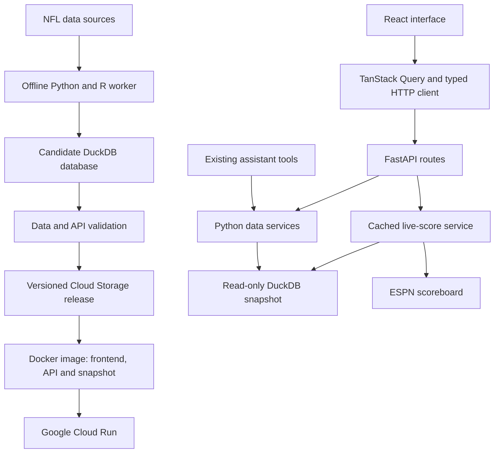

# NFLDB architecture

React and FastAPI run in one Cloud Run service with a prepared DuckDB database.

The image contains the built interface, FastAPI application and verified database.
Each Cloud Run instance reads its own copy of the snapshot.

| Component | Responsibility | Entry points |
|---|---|---|
| Interface | Pages, charts, navigation and display choices | `frontend/src/features/`, `frontend/src/main.tsx` |
| Request client | Typed requests, cached results, loading, retry and cancellation | `frontend/src/api/` |
| HTTP API | Validate parameters/responses and translate service errors | `api/main.py`, `api/routers/` |
| Data services | Queries and assembly shared with assistant tools | `api/services/` |
| Prepared analytics | Ratings, rankings, splits and comparables built offline | `api/pipeline/analytics.py`, `api/*_builder.py` |
| Live scores | Paced network requests, caching and schedule fallback | `api/live/` |
| Publication | Validate, upload, select and download immutable releases | `api/jobs/`, `api/publication/` |

Analytics builders prepare tables offline. Their read functions serve the
published results.

### Example: opening receiving splits

1. React requests `/api/players/{player_id}/receiving-splits` through the typed client.
2. FastAPI calls `services.receiving_splits.read_player_receiving`.
3. The service reads prepared totals, situational rows and coverage metadata.
4. The interface displays supported values and explains unavailable fields.
   Combined seasons use the prepared aggregation ingredients.

The request does not run R, download play-by-play or create missing analytics.

### Data updates

The scheduled refresh captures sources, runs the pinned calculator and builds a
separate writable candidate. Validation checks sources, supported statistics,
coverage and API responses before publication. Deployment consumes the selected
release and tests the image before moving production traffic.

Optional feeds can retain older data after known download failures. A successful
publication does not establish that every vendor is current or every field and
historical game is complete. See the [data map](DATA_MAP.md),
[refresh workflow](NATIVE_REFRESH_AUTOMATION.md) and [deployment guide](../DEPLOY.md).
