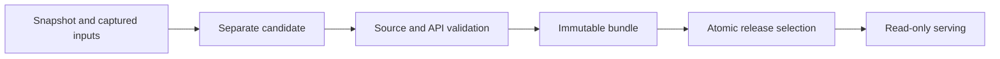

# Offline native releases

Preparation, validation and publication are separate. Creating a bundle never
replaces the source database or the current release.



## Prepare a candidate and bundle

From `api/`, with new output paths and existing parent directories:

```powershell
uv run --locked python -m jobs.refresh prepare watermarks.json `
  --source data/previous.duckdb --candidate data/new-candidate.duckdb `
  --release data/releases/new-release --seasons 2026 `
  --core-inputs PATH_TO_CORE_COLLECTION --passing-inputs PATH_TO_PASSING_COLLECTION
```

The source must be closed without a WAL. Its copy is built in a writable worker
and validated in a read-only process. Bundling validates again under a read lock
and copies exactly those validated bytes. A failure leaves the prior release and
its acknowledged watermarks untouched.

The command deliberately rebuilds **all analytics metadata** against the supplied
collections. It reuses unchanged historical exports without rerunning R. This
avoids stale historical collection revisions until per-season metadata gains a
stable leaf identity; it prioritizes correctness over current-only build speed.

## Bundle an already prepared candidate

```powershell
uv run --locked python -m jobs.release build `
  --database data/new-candidate.duckdb --output data/releases/new-release `
  --core-inputs PATH_TO_CORE_COLLECTION --passing-inputs PATH_TO_PASSING_COLLECTION `
  --watermarks watermarks.json
```

This neither downloads data nor advances timestamps. Omitting watermarks creates
an empty acknowledgment map. The bundle contains `nfl.duckdb`, `validation.json`,
`watermarks.json` and a `release.json` completion marker written last. File sizes,
hashes and validation-code revision are verified before selection. Relevant
Python/API/schema/pipeline or dependency-lock changes require validation again;
line endings are normalized for portability. This provides integrity and
provenance, without claiming a signature or fresh upstream data.

The temporary blanket publication block is replaced by concrete native checks:
both receiving and passing preparation, matching captured inputs, historical
statistical checks and HTTP reads. A legacy or receiving-only snapshot cannot
become a native release. Preparation records themselves remain non-certifying;
the complete release-level report determines readiness.

## Select a local release

```powershell
uv run --locked python -m jobs.release verify --release data/releases/new-release
uv run --locked python -m jobs.release select-local `
  --release data/releases/new-release --pointer data/releases/current.json
```

First publication requires an absent pointer. Updates require
`--expected-pointer-sha256` with the hash the caller read. An exclusive writer
reservation and atomic replacement prevent stale/concurrent publishers from
silently replacing a newer selection. Database and watermarks are selected
together through one immutable directory. Failed copying, verification or
selection leaves the previous pointer. Keep pointers outside release directories.
After a crash, confirm the publisher stopped before removing its stale `.lock`.

This changes only the named **local pointer**. It does not replace the working
database, change environment settings, upload to GCS or deploy. A running service
continues using its opened snapshot until deployment selects a new artifact.

## Watermarks and cloud status

Refresh observes versions before and after preparation, with a fresh post-build
API read. It advances only stable versions successfully loaded by this run, or
supported empty optional vendor feeds. Failed, missing, unsupported, unobserved
or mid-build changed sources retain their marks. Packaging an old candidate
carries only explicitly supplied, previously acknowledged marks.

Old captured play-by-play and weekly data do not prove today's upstream files
were consumed. [Native source-version proofs](UPSTREAM_PROVENANCE.md) now bind
RDS play-by-play, weekly stats and detailed credits to verified consumed inputs.
Only matching proofs and loaded outcomes can acknowledge those native keys;
legacy parquet keys are never acknowledged by RDS evidence.

The local protocol and [portable capture packing/restore](CAPTURE_ARCHIVES.md)
and native source-version proofs are implemented. Cloud migration still needs
fresh capture/passing/collection orchestration, capture upload/download wiring,
immutable GCS prefixes, a
generation-matched current pointer and deployment consuming that bundle. The
scheduled workflow still has its legacy ingest/upload path; do not describe it
as migrated or run it as a native release workflow yet.

## Local proof (October 28, 2026)

The native bundle passed receiving and passing source validation for all 28
seasons (1999–2026), historical statistical checks and 102 HTTP reads. Its
database is byte-for-byte identical to the validated candidate. This establishes
correctness against the supplied captures, not current upstream freshness.

A workspace-only selection test selected that bundle, rejected a stale update,
confirmed read-only database access and left the source and bundled database
unchanged. The bundle contains empty watermarks because packaging existing
captures does not acknowledge new upstream versions. No serving configuration or
cloud deployment changed.

The release, refresh and related validation suites have 148 distinct passing
checks, including failure cases for copying, validation, corruption, concurrent
publication, policy changes and upstream changes during preparation. Local proof
logs and databases are ignored under `api/data/`.

## Fresh-season refresh proof (October 28, 2026)

The ordinary `jobs.refresh prepare` command completed against a separate copy of
the prepared database, using new 2026 core/receiving and passing captures with
the original 1999–2025 exports. The candidate gate and final release gate both
passed all 28 seasons and 102 HTTP checks. Relevant statistical tolerances and
availability rules were unchanged.

Every historical passing/receiving split row for 1999–2025 is exactly identical
to the source database, checked with bidirectional `EXCEPT ALL`. Updated 2026
split-row counts are:

| Category | Previous | Refreshed |
| --- | ---: | ---: |
| Passing | 1,793 | 1,831 |
| Receiving | 4,611 | 4,706 |
| Rushing | 2,991 | 3,028 |

The completed bundle contains a byte-identical copy of the candidate and 12
acknowledged 2026 source versions. Its three native RDS marks exactly match the
hash-verified capture proof; no legacy parquet keys were acknowledged. The
matching input archive contains 4,741 files; every payload hash and its collection
revisions were verified, including preservation of the new provenance files.

All five protected working/proof databases, the old input manifests, previous
watermarks and local demonstration pointer remain unchanged. The 85 targeted
input-composition, provenance, refresh, release and candidate controls passed.
Logs/artifacts remain ignored under `api/data/`. This proves the complete local
refresh path; cloud transport, atomic cloud selection and deployment remain
separate work. No release was selected or deployed by this trial.
